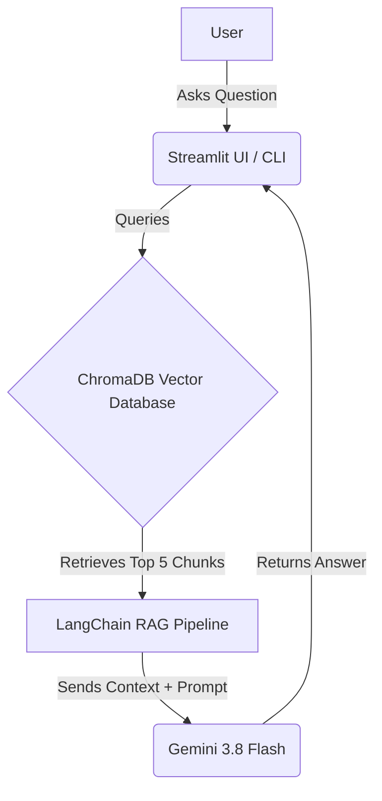

# 📄 Gemini RAG Policy Bot

A Retrieval-Augmented Generation (RAG) application that allows users to chat with a company policy PDF. Built with **LangChain**, **Google Gemini**, **ChromaDB**, and **Streamlit**.

## 🎯 Business Problem

Employees waste hours searching through dense corporate handbooks to find specific policies (e.g., Health & Safety, IT Security). This bot acts as an instant, accurate HR assistant that strictly answers based *only* on the provided document, eliminating hallucinations.

## 🏗️ Architecture



- **Ingestion (`ingest.py`)** — Reads `policy.pdf`, splits it into 500-character chunks, and converts them into vector embeddings using Gemini's `gemini-embedding-001` model.
- **Storage** — Stores the embeddings locally using ChromaDB (a vector database).
- **Retrieval & Generation (`app.py` / `chat.py`)** — When a user asks a question, the app retrieves the top 5 most relevant chunks and sends them to `gemini-3.8-flash` to generate a strict, context-aware answer.

## 🚀 How to Run Locally

1. **Clone this repository.**

   ```bash
   git clone <your-repo-url>
   cd <your-repo-name>
   ```

2. **Create a virtual environment:**

   ```bash
   python -m venv venv
   ```

3. **Activate the environment:**

   - Windows: `venv\Scripts\activate`
   - Mac/Linux: `source venv/bin/activate`

4. **Install dependencies:**

   ```bash
   pip install -r requirements.txt
   ```

5. **Add your Google Gemini API key** to a `.env` file in the root directory:

   ```env
   GEMINI_API_KEY=your_key_here
   ```

6. **Add a PDF document** to the root folder and name it `policy.pdf`.

7. **Run the ingestion script** to build the vector database:

   ```bash
   python ingest.py
   ```

8. **Start the application!**

   - For the Web UI: `streamlit run app.py`
   - For the Terminal CLI: `python chat.py`

## 🧠 Technical Optimizations

- **Transport Layer Fix** — Configured `transport="rest"` to ensure compatibility with new Google API key formats and resolve DNS/gRPC connection hangs.
- **Retrieval Tuning** — Increased the retriever `k` value from 3 to 5 to improve the accuracy of retrieving specific statistical data (e.g., the 1.5° climate target) from dense text.
- **Prompt Engineering** — Strict system prompt prevents hallucinations by forcing the LLM to say "I don't know" if the answer isn't in the retrieved context.
- **Security** — Implemented `.gitignore` rules and environment variables to ensure API keys are never exposed in the repository.